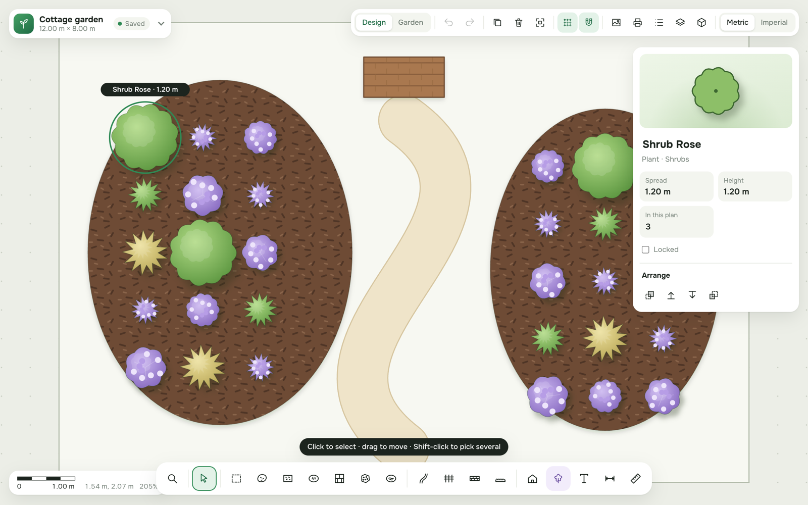
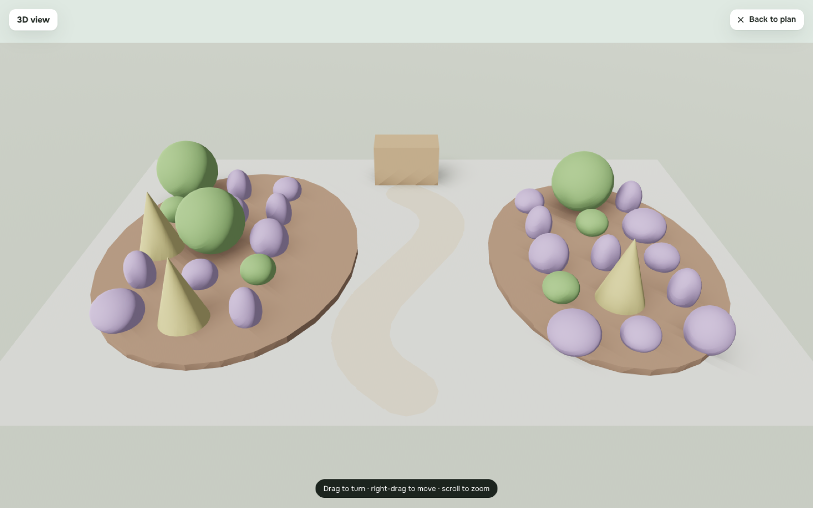

<div align="center">


# Loma

**Plan your garden to the centimetre, see it in 3D, then look after it season by season.**
Runs in the browser, installs like an app, works offline. No account, no server.

[**Open Loma →**](https://azarcore.github.io/loma/)

</div>



Loma starts where most garden plans do — a plot, some beds, a path, the plants you love — and keeps going after the
planting is done. Draw the layout at real scale, check it in 3D, print it for the garden centre, then switch to
**Garden mode** to keep each plant's health, notes, photos and care history, and let a care calendar tell you what's
due this week.

It's built in Rust and compiled to WebAssembly, so the whole app runs on your device. Your designs never leave it
unless you export them.

## What you can do

### Design

- **Draw at real scale.** Plot boundary, beds (free-form, curved or rectangular), lawn, paving, gravel, water, paths,
  fences, walls, hedges and structures like sheds, greenhouses, pergolas and raised beds. Metric or imperial.
- **94 plants in a searchable catalog** — trees, fruit and nut trees, shrubs, perennials, grasses, climbers,
  vegetables and herbs — each with a realistic full-grown spread and height. Search by common or botanical name
  ("malus", "pomegranate"), or add your own plants.
- **Precision when you need it.** Smart guides that line things up and space them evenly, snapping to grid and
  objects, exact lengths and angles for every edge, curved edges, point editing, dimensions and a measure tool.
- **Layers**, lock and hide, arrange front to back, undo and redo for everything.
- **Trace a photo or survey plan** under your design and set its scale from one known distance.
- **Start from a template:** small back garden, front garden, cottage garden, vegetable plot or courtyard.

<p align="center">
</p>

### See it and share it

- **3D view** you can orbit, pan and zoom with mouse or touch, loaded only when you open it.
- **Print** to scale on one page or tiled across several, with trim marks, and export **SVG** or **PNG**.
- **Garden list:** everything the design needs — plants by kind, areas in m², gravel by volume, fence and hedge
  lengths, structures — with your own prices, a total, **CSV** export and a printable shopping list.

### Look after it — Garden mode

- **A card for every plant and hedge:** health (healthy, watch, sick, gone — shown on the plan), notes, dated photos
  and a full history of what was done.
- **Log jobs** — sprayed, fed, pruned, watered, harvested, planted — for one plant or many at once.
- **Products library with label intervals you enter** (days before harvest, days between applications, most per
  year). Loma works out when each plant is safe to harvest, warns when a spray goes against the label, and never
  invents intervals of its own.
- **Care calendar:** repeating jobs for one plant, a kind ("every apple") or a category ("all fruit trees"), every N
  days or weeks or once a year, optionally only in certain months. A **This week** list shows what's overdue, due and
  coming up, with Done and Skip.


### Take it into the garden

- **Install it** on your phone or computer from the browser — it opens full screen and **works offline** once loaded.
- **Reminders without a server:** a "jobs due today" banner, a due count on the app icon, a daily notification on
  Android, and **Add to calendar** to put the next 60 days of jobs, with reminders, into your phone's own calendar.
- Updates arrive quietly the next time you open it, never in the middle of what you're doing.

## Your data

- Designs, photos and settings are stored **in your browser on your device** (IndexedDB). There is no account and no
  server; nothing is uploaded.
- Move a design between devices with **Download .loma.json** and **Import**.
- The page loads its typeface (Onest) from Google Fonts; nothing else is fetched from third parties.

## Run it yourself

You'll need Rust (2024 edition, stable), the WebAssembly target, [Trunk](https://trunkrs.dev) and the
`wasm-bindgen` command-line tool at the version pinned in `Cargo.lock` (used for the 3D bundle):

```bash
rustup target add wasm32-unknown-unknown
cargo install trunk --version 0.22.2
cargo install wasm-bindgen-cli --version 0.2.130
```

Then:

```bash
cd crates/loma-web
trunk serve            # http://localhost:8080, rebuilds as you edit
```

```bash
cargo test --workspace # the model, editor logic, dates and file format
trunk build --release  # the installable, offline-ready app in crates/loma-web/dist
```

The offline cache is only switched on in release builds, so development keeps live reload.

### Publishing

`scripts/publish.sh` builds the release app from the current commit and pushes just the built files to the
`gh-pages` branch, which GitHub Pages serves. `--dry-run` does everything except the push.

## How it's built

| Crate | What it does |
| --- | --- |
| [`loma-core`](crates/loma-core) | The design model, geometry, undoable commands, calendar dates and the file format. No UI, fully tested. |
| [`loma-editor`](crates/loma-editor) | Everything the editor does, independent of the browser: tools, selection, smart guides, the catalog, the garden list, care rules and the calendar. Tested natively. |
| [`loma-scene`](crates/loma-scene) | Turns a design into 3D geometry. |
| [`loma-3d`](crates/loma-3d) | The [Bevy](https://bevyengine.org) 3D viewer, shipped as a separate bundle that downloads only when you open 3D. |
| [`loma-web`](crates/loma-web) | The app itself: [Leptos](https://leptos.dev) UI, SVG plan, storage, printing, the offline service worker and reminders. |

Keeping the logic in plain Rust crates means almost everything — geometry, undo, label rules, due dates, calendar
files — is covered by fast native tests, while the browser layer stays thin.

## Where it's heading

Gardens are the start. The same plan-to-scale, see-it-in-3D, keep-it-up-to-date idea fits a whole home: room
layouts, furniture, and the planning around a house. Loma's name and structure are chosen to grow that way.

## Licence

Copyright © 2026 azarcore

Licensed under the [Apache License, Version 2.0](LICENSE). You may use, change and share Loma — including in your
own products — as long as you keep the copyright notice and the licence, and note any changes you make. It comes
**without any warranty**; see the [licence](LICENSE) for the details.
