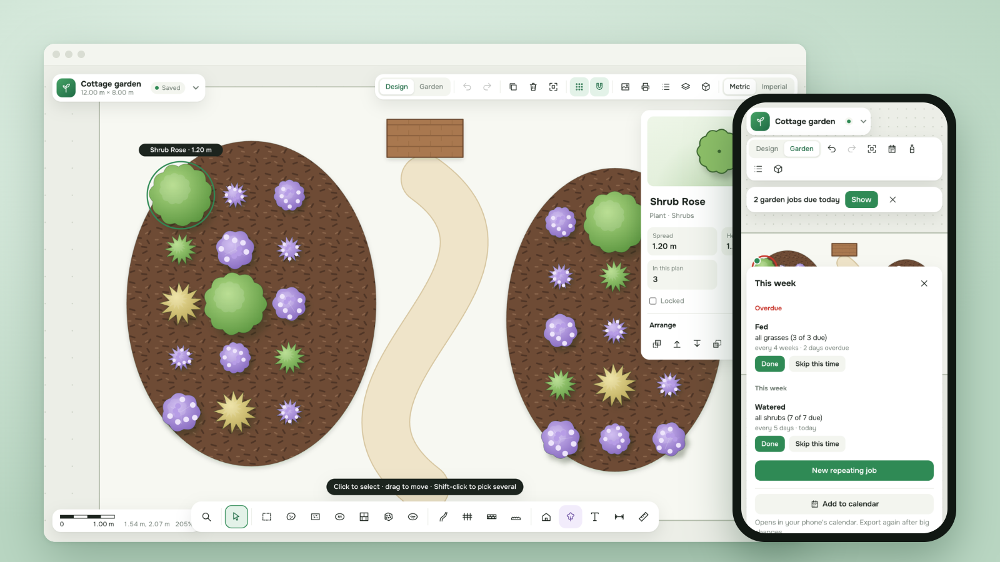
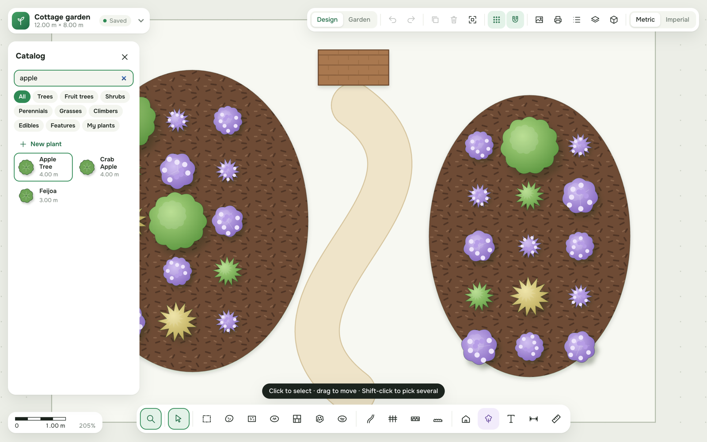
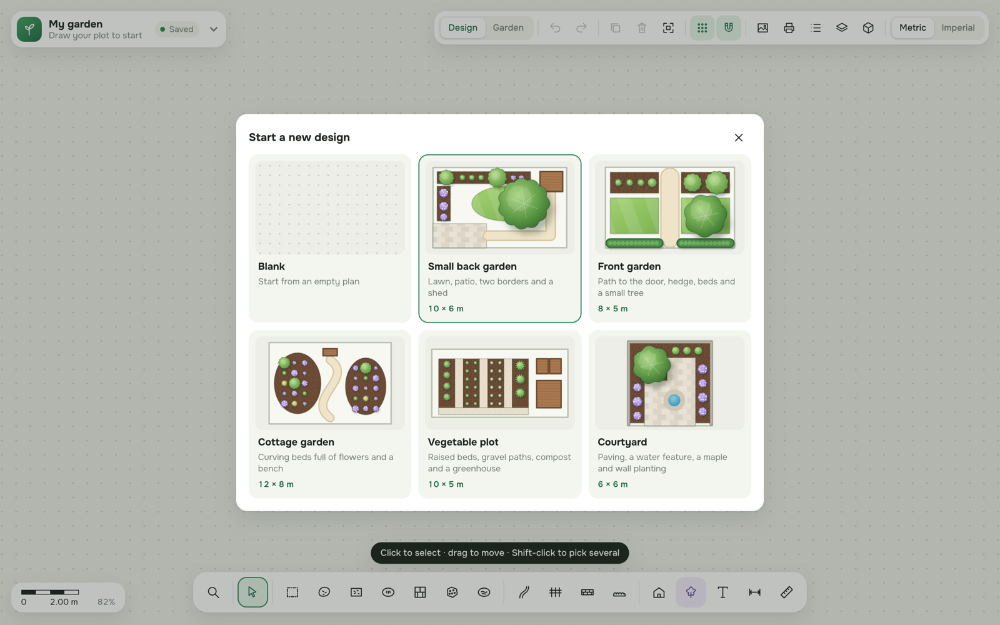
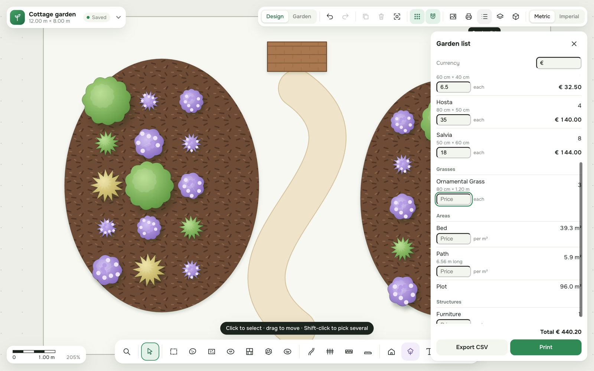
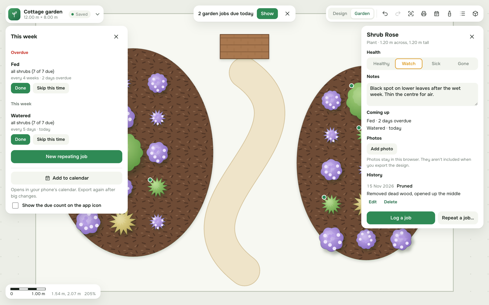
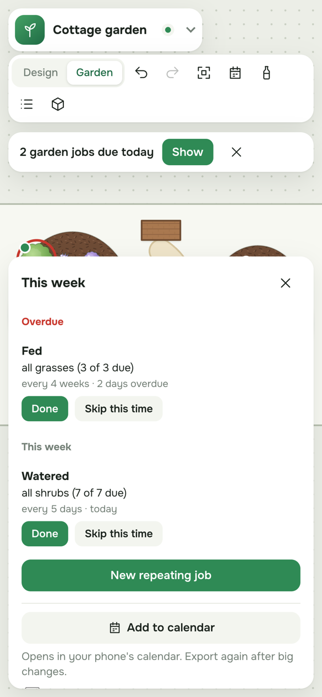
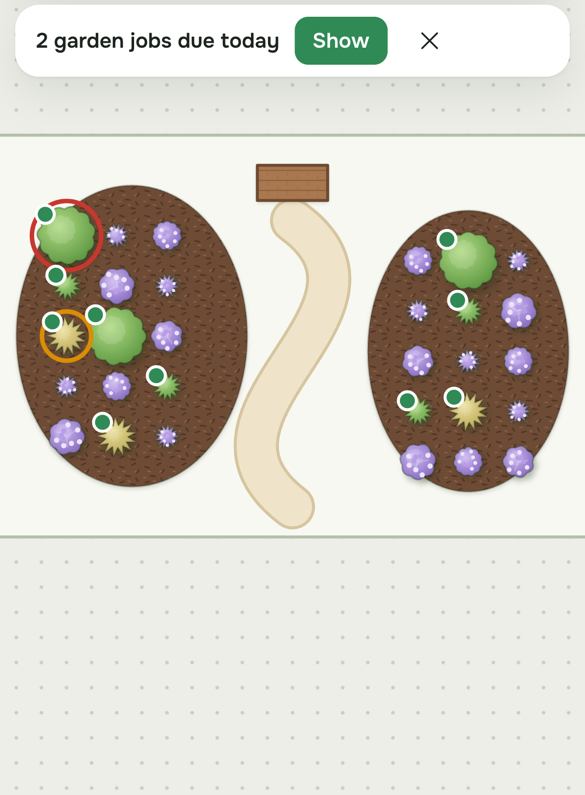

<div align="center">


# Loma

### Plan your garden to the centimetre. See it in 3D. Look after it, season after season.

A free garden planner that runs in your browser, installs like an app and keeps working with no signal.<br />
No account, no server, no tracking — your designs stay on your device.

[](https://azarcore.github.io/loma/)

[](LICENSE)


[Features](#features) · [Try it](#try-it-in-a-minute) · [FAQ](#faq) · [Run it yourself](#run-it-yourself) · [Contributing](#contributing)

</div>

<br />

<p align="center"></p>

<br />

Most garden planners stop the day you finish drawing. Loma keeps going. Draw the plot, beds, paths and plants at real
scale, check the result in 3D and print a shopping list. Then switch to **Garden mode**, where every plant has its own
card — health, notes, photos, a history of what was done — and a care calendar tells you what needs doing this week.

<table>
<tr>
<td width="33%" valign="top">

**📐 Plan it**<br />
Real measurements, 94 plants with true full-grown sizes, smart guides, templates to start from.

</td>
<td width="33%" valign="top">

**🌳 See it**<br />
Walk around it in 3D, print it to scale, get a priced list of everything it needs.

</td>
<td width="33%" valign="top">

**🌱 Keep it**<br />
Log every job, track plant health, follow spray labels, get reminded when things are due.

</td>
</tr>
</table>

## Try it in a minute

1. **[Open Loma](https://azarcore.github.io/loma/)** and pick a template — *Cottage garden* is a good start — or a blank plot.
2. **Draw.** Press <kbd>B</kbd> for a bed, <kbd>/</kbd> to find a plant, then click to place it. Everything snaps and
   measures as you go.
3. Press <kbd>3</kbd> to see it in **3D**.
4. Switch to **Garden** in the top bar, tap a plant and **log a job**, or set up one that repeats.
5. On your phone, choose **Add to Home Screen** (iPhone) or **Install** (Android) to keep it with you in the garden.

## Features

### Design at real scale

<table>
<tr>
<td width="46%" valign="top">

- **Everything a garden is made of:** plot boundary, beds (free-form, curved or rectangular), lawn, paving, gravel,
  water, paths, fences, walls, hedges and structures — sheds, greenhouses, pergolas, raised beds, furniture.
- **94 plants in a searchable catalog** — trees, fruit and nut trees, shrubs, perennials, grasses, climbers,
  vegetables and herbs — each at its real full-grown spread and height. Search by common or botanical name
  (*malus*, *pomegranate*), or add your own plants.
- **Precision tools:** smart guides that align and evenly space things, snapping to grid and objects, exact edge
  lengths and corner angles, curved edges, point editing, dimension lines and a measure tool.
- **Layers** to hide and lock, arrange front to back, and **undo** for everything.
- **Trace over a photo or survey** and set its scale from one known distance.
- **Metric or imperial**, switchable at any time.

</td>
<td width="54%" valign="top">



</td>
</tr>
</table>

### Start from a template, see it in 3D

<p>
</p>

Five ready-made gardens to adapt, or a blank plot. The **3D view** turns the plan into raised beds, shrubs and
trees at their full-grown size; orbit, pan and zoom with mouse or touch. It downloads only when you open it, so the
app itself stays quick to load.

### From plan to shopping list

<table>
<tr>
<td width="54%" valign="top">



</td>
<td width="46%" valign="top">

- **The garden list** counts what your design needs: plants by kind, areas in m² or ft², gravel by volume, fence,
  wall and hedge lengths, structures.
- **Add your own prices** in any currency and get a running total. Prices stay right when you switch units.
- **Export CSV** for a spreadsheet, or **print** a tidy shopping list for the garden centre.
- **Print the plan to scale** — on one page, or tiled across several with trim marks so the pieces line up — and
  export **SVG** or **PNG**.

</td>
</tr>
</table>

### Look after every plant

<p></p>

**Garden mode** locks the layout so nothing moves by accident, and turns every plant and hedge into a card:

- **Health** — healthy, watch, sick or gone — shown as rings on the plan, so problems stand out.
- **Notes and dated photos** for each plant.
- **A log of jobs** — sprayed, fed, pruned, watered, harvested, planted — for one plant or many at once.
- **A products library** where you copy intervals from the label: days before harvest, days between applications,
  most applications a year. Loma shows when each plant is **safe to harvest** and warns when a spray goes against
  the label. It never makes intervals up.
- **A care calendar:** jobs that repeat for one plant, a kind (*every apple*) or a category (*all fruit trees*) —
  every so many days or weeks, or once a year, optionally only in certain months. **This week** lists what's
  overdue, due and coming up, with **Done** and **Skip**.

### In your pocket

<table>
<tr>
<td width="38%" valign="top">



</td>
<td width="62%" valign="top">

- **Install it** from the browser on iPhone, Android or desktop. It opens full screen with its own icon.
- **Works offline** once it has loaded — handy at the far end of the garden.
- **Reminders without a server:**
  - a *"2 garden jobs due today"* banner when you open it,
  - a due count on the app icon,
  - a daily notification on Android,
  - **Add to calendar** puts the next 60 days of jobs, with reminders, into your phone's own calendar.
- **Touch-friendly:** tap to select, drag to pan, and orbit, pan and pinch-zoom in 3D.
- **Quiet updates:** new versions arrive the next time you open the app, never in the middle of what you're doing.



</td>
</tr>
</table>

<details>
<summary><b>Keyboard shortcuts</b></summary>

<br />

| Key | Tool | | Key | Tool |
| --- | --- | --- | --- | --- |
| <kbd>V</kbd> | Select | | <kbd>F</kbd> | Fence |
| <kbd>K</kbd> | Plot boundary | | <kbd>W</kbd> | Wall |
| <kbd>B</kbd> | Bed | | <kbd>H</kbd> | Hedge |
| <kbd>R</kbd> | Rectangular bed | | <kbd>S</kbd> | Structure |
| <kbd>E</kbd> | Lawn | | <kbd>G</kbd> | Plant |
| <kbd>A</kbd> | Paving | | <kbd>T</kbd> | Text |
| <kbd>X</kbd> | Gravel | | <kbd>D</kbd> | Dimension |
| <kbd>O</kbd> | Water | | <kbd>M</kbd> | Measure |
| <kbd>P</kbd> | Path | | | |

| Key | Does |
| --- | --- |
| <kbd>/</kbd> | Search the plant catalog |
| <kbd>3</kbd> | Open the 3D view |
| <kbd>Ctrl</kbd>/<kbd>⌘</kbd> + <kbd>Z</kbd> | Undo (add <kbd>Shift</kbd> to redo, or use <kbd>Ctrl</kbd> + <kbd>Y</kbd>) |
| <kbd>Ctrl</kbd>/<kbd>⌘</kbd> + <kbd>D</kbd> | Duplicate the selection |
| <kbd>Delete</kbd> | Delete the selection |
| <kbd>Enter</kbd> | Finish the shape you're drawing |
| <kbd>Esc</kbd> | Cancel the current step |
| <kbd>Space</kbd> + drag | Pan the plan |

</details>

## Your data stays yours

- Designs, photos and settings live **in your browser, on your device**. There's no account, no server and no
  analytics; nothing you draw or write is uploaded.
- To move a design to another device — or keep a backup — use **Download .loma.json** in *My designs*, then
  **Import** it on the other side.
- Photos stay on the device where you took them; they aren't included in exported designs.
- The only outside request is the typeface (Onest), loaded from Google Fonts.

## FAQ

<details>
<summary><b>Is it free?</b></summary>

Yes. Loma is free to use and open source under the Apache 2.0 licence.
</details>

<details>
<summary><b>Will I lose my designs if I clear my browser?</b></summary>

Yes — clearing a site's data in the browser removes what's stored there. Download your designs as `.loma.json` from
time to time; they import back in seconds.
</details>

<details>
<summary><b>Do reminders work on iPhone?</b></summary>

iPhone doesn't let web apps run in the background, so there's no daily notification. Use **Add to calendar** in the
This week card: your jobs land in the Calendar app with their own reminders. The due count on the app icon works on
iOS 16.4 and later once the app is on your Home Screen.
</details>

<details>
<summary><b>Where do the spray and harvest intervals come from?</b></summary>

From you. You copy them from each product's label into the products library. Loma uses them to work out safe dates
and warnings, and never guesses or supplies intervals of its own.
</details>

<details>
<summary><b>Can I use it for things other than gardens?</b></summary>

Today it's built around gardens: plants, beds, paths, care. Its drawing tools work for any outdoor space, and home
layouts are where it's heading next (see below).
</details>

## Where it's heading

**Done**

- [x] Real-scale plan editor with smart guides, layers and precision editing
- [x] Plant catalog, custom plants and templates
- [x] 3D view, printing to scale, SVG/PNG export
- [x] Garden list with prices and CSV
- [x] Garden mode: plant cards, health, job log, photos, products and safe dates
- [x] Care calendar with repeating jobs
- [x] Installable, offline, reminders

**Ideas for next**

- [ ] Rooms and furniture: plan the house as well as the garden
- [ ] More plants, and plant information beyond size
- [ ] Optional sync between your devices
- [ ] More languages

## Run it yourself

You'll need stable Rust (2024 edition), the WebAssembly target, [Trunk](https://trunkrs.dev) and the
`wasm-bindgen` command-line tool at the version pinned in `Cargo.lock` (it builds the 3D bundle):

```bash
rustup target add wasm32-unknown-unknown
cargo install trunk --version 0.22.2
cargo install wasm-bindgen-cli --version 0.2.130
```

Run the app with live reload at http://localhost:8080:

```bash
cd crates/loma-web
trunk serve
```

Test, and build the installable app into `crates/loma-web/dist`:

```bash
cargo test --workspace
trunk build --release
```

The offline cache is only switched on in release builds, so development keeps live reload.
`scripts/publish.sh` builds a release from the current commit and pushes it to the `gh-pages` branch, which GitHub
Pages serves (`--dry-run` stops before the push).

### How it's put together

| Crate | What it does |
| --- | --- |
| [`loma-core`](crates/loma-core) | The design model, geometry, undoable commands, calendar dates and the file format. No UI. |
| [`loma-editor`](crates/loma-editor) | Everything the editor does, independent of the browser: tools, selection, smart guides, the catalog, the garden list, care rules and the calendar. |
| [`loma-scene`](crates/loma-scene) | Turns a design into 3D geometry. |
| [`loma-3d`](crates/loma-3d) | The [Bevy](https://bevyengine.org) 3D viewer, a separate bundle that loads only when you open 3D. |
| [`loma-web`](crates/loma-web) | The app: [Leptos](https://leptos.dev) interface, SVG plan, storage, printing, the offline service worker and reminders. |

The browser layer is kept thin on purpose. Geometry, undo, label rules, due dates, calendar files and the list maths
all live in plain Rust crates and are covered by fast native tests.

## Contributing

Ideas, bug reports and pull requests are welcome. Please open an issue first for anything large, so we can agree on
the approach.

Before sending a change:

```bash
cargo fmt --all
cargo test --workspace
cargo clippy --workspace --all-targets -- -D warnings
cargo clippy -p loma-web --target wasm32-unknown-unknown -- -D warnings
```

New behaviour should come with a test in the crate that owns it — usually `loma-core` or `loma-editor`, where the
logic lives. All user-facing text is in `crates/loma-editor/src/strings.rs`.

## Licence

Copyright © 2026 azarcore

Licensed under the [Apache License, Version 2.0](LICENSE). You may use, change and share Loma — including in your
own products — as long as you keep the copyright notice and the licence, and note any changes you make. It comes
**without any warranty**; see the [licence](LICENSE) for the details.
